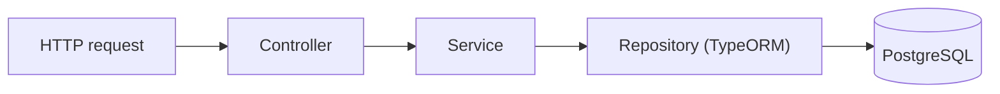
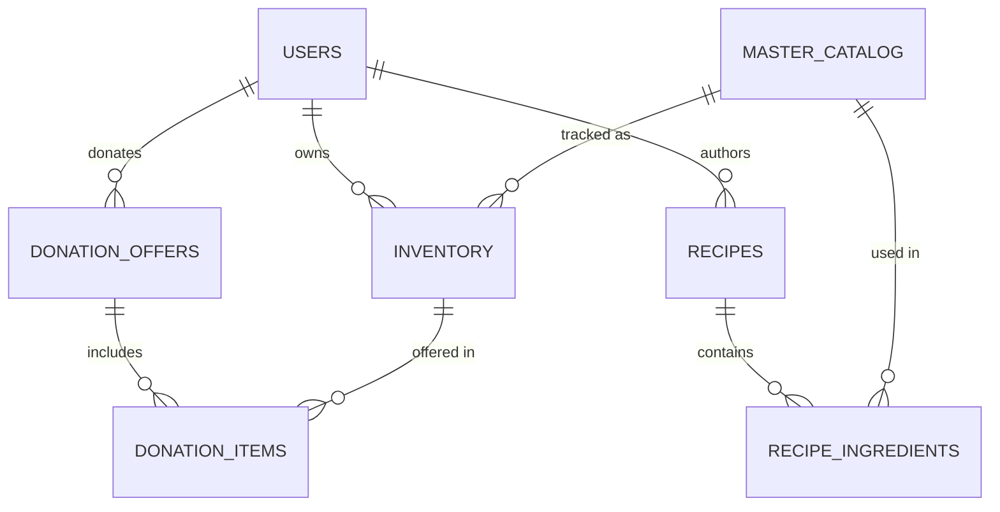

# 🍓 FreshTrack

**Know what you have. Use it before it expires.**

FreshTrack is a smart food inventory app designed to reduce food waste. It helps people keep track of the groceries they have at home, stay ahead of expiration dates, turn food that is about to expire into meals, and donate what they cannot use.

> 🚧 **Status:** in active development. This repository holds the backend (D2) of the *Full Stack Web Development* semester project at Universidad Icesi.

---

## Table of contents

- [The problem](#the-problem)
- [Core features](#core-features)
- [Roles](#roles)
- [Tech stack](#tech-stack)
- [How it works](#how-it-works)
- [Data model](#data-model)
- [Project structure](#project-structure)
- [Getting started](#getting-started)
- [Team workflow](#team-workflow)
- [Team](#team)
- [Roadmap](#roadmap)

---

## The problem

We buy food with the best intentions, but we lose track of what is at home. Expiration dates are easy to overlook, duplicate purchases become more likely, and food ends up in the trash along with the money spent on it.

We ran a short survey to validate the problem:

| Finding | Result |
|---|---|
| Have had food expire or go bad before consuming it | **66%** |
| Don't systematically track what they have at home | **70%** |
| Would find expiration reminders useful | **80%** |

FreshTrack gives people visibility over their food inventory so they can act before it expires.

## Core features

### 1. Smart Inventory
Users register the products they have, with quantity and expiration date, using a shared **master catalog** of base products. The system helps them see what needs attention first.

### 2. Recipe Recommendations
Recipes are built from catalog products, so FreshTrack can suggest what to cook with the ingredients a user already has. Community recipes go through **admin moderation** (`pending → approved / rejected`).

### 3. Donations
Instead of throwing food away, users can offer inventory items as a donation. An **admin reviews each offer** and accepts or rejects it (`pending → accepted / rejected`). Each user also keeps a running total of the kilograms they have rescued.

## Roles

| Role | What they can do |
|---|---|
| **User** | Manage their own inventory, explore recipes, and create donation offers |
| **Admin** | Manage the master catalog, moderate recipes, and accept or reject donations |

## Tech stack

| Layer | Technology |
|---|---|
| Backend | [NestJS](https://nestjs.com/) (TypeScript) |
| Database | PostgreSQL + [TypeORM](https://typeorm.io/) |
| Infrastructure | Docker and Docker Compose |
| Testing | Jest (unit tests with mocks) and Postman |
| Frontend *(planned)* | Next.js + React |
| Authentication *(planned)* | JWT, Passport and role-based guards |

## How it works

Every request follows the same path through the backend, and each piece has a single responsibility:



- **Controller:** receives the request, reads params, query and body, and delegates.
- **DTOs and pipes:** validate the incoming data before it reaches the controller method.
- **Service:** coordinates the operation and applies business rules (for example, a donation can only be accepted if it is still pending).
- **Repository:** reads and writes the data through TypeORM.

The backend is organized in feature modules (`inventory`, `recipes`, `donations`) that share a common set of entities.

## Data model



| Table | Purpose |
|---|---|
| `users` | Accounts, role and rescued kilograms |
| `master_catalog` | Base food products with category and average shelf life |
| `inventory` | A user's products with quantity and expiration date |
| `recipes` | Recipes with preparation time and moderation status |
| `recipe_ingredients` | Links recipes with the catalog products they require |
| `donation_offers` | A user's donation and its review status |
| `donation_items` | Links a donation with the inventory items it includes |

## Project structure

```
web-freshtrack/
└── backend/
    ├── compose.yaml          # PostgreSQL with Docker Compose
    ├── .env.example          # Environment variables template
    ├── scripts/
    │   └── seed.sql          # Test users and catalog products
    └── src/
        ├── entities/         # TypeORM entities shared by all modules
        ├── inventory/        # Smart Inventory module
        ├── recipes/          # Recipe Recommendations module
        ├── donations/        # Donations module
        ├── app.module.ts
        └── main.ts
```

## Getting started

### Prerequisites

- Node.js 20 or higher and npm
- Docker Desktop
- Git
- *Optional:* DBeaver (to inspect the database) and Postman (to test the API)

### Installation

```bash
git clone https://github.com/Laurapalacioh127/Web---FreshTrack.git
cd Web---FreshTrack/backend

npm install --legacy-peer-deps
cp .env.example .env
```

Open `.env` and set `DB_PASSWORD=postgres` to match the local Docker database.

### Environment variables

| Variable | Description | Local value |
|---|---|---|
| `DB_HOST` | Database host | `localhost` |
| `DB_PORT` | Database port | `5432` |
| `DB_USERNAME` | Database user | `postgres` |
| `DB_PASSWORD` | Database password | `postgres` |
| `DB_DATABASE` | Database name | `freshtrack` |

> The `.env` file is never committed. Only `.env.example` is shared.

### Run the project

```bash
docker compose up -d      # start PostgreSQL
npm run start:dev         # start the API in watch mode
```

The API is available at `http://localhost:3000/api`. On the first run, TypeORM creates the tables automatically (`synchronize` is enabled for local development only, never use it with real data).

### Load test data

The tables start empty. Load a couple of users and some catalog products with the seed script, either from the DBeaver SQL editor or from the terminal:

```bash
docker compose exec -T postgres psql -U postgres -d freshtrack < scripts/seed.sql
```

### Useful commands

```bash
docker compose ps           # check that the database is running
docker compose logs         # view database logs
docker compose down         # stop and remove the containers
npm run build               # compile the project
npm test                    # run unit tests
```

## Team workflow

- `main` always holds stable code. Nobody pushes directly to it.
- One branch per feature: `feature/inventory`, `feature/recipes`, `feature/donations`.
- Each feature lives in its own module folder to avoid conflicts.
- Changes reach `main` through Pull Requests reviewed by another teammate.
- Commits are small and descriptive, so each contribution is easy to follow.

## Team

| Member | Responsibility |
|---|---|
| Laura | Project base, database model and **Inventory** |
| Francisco | **Donations** |
| Nayo | **Recipes** |

## Roadmap

- [x] **D1:** problem definition, requirements, data model, prototype and planning
- [ ] **D2:** functional backend
  - [x] Project setup, Docker and database connection
  - [x] Entities and relations
  - [ ] Inventory, Recipes and Donations modules
  - [ ] Input validation with DTOs and pipes
  - [ ] Unit tests and Postman collection
  - [ ] Authentication and role-based authorization
  - [ ] Deployment
- [ ] **D3:** frontend connected to the backend
- [ ] **DF:** final delivery

---

*Built for the Full Stack Web Development course at Universidad Icesi, 2026.*
